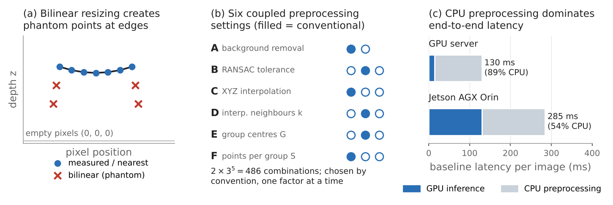
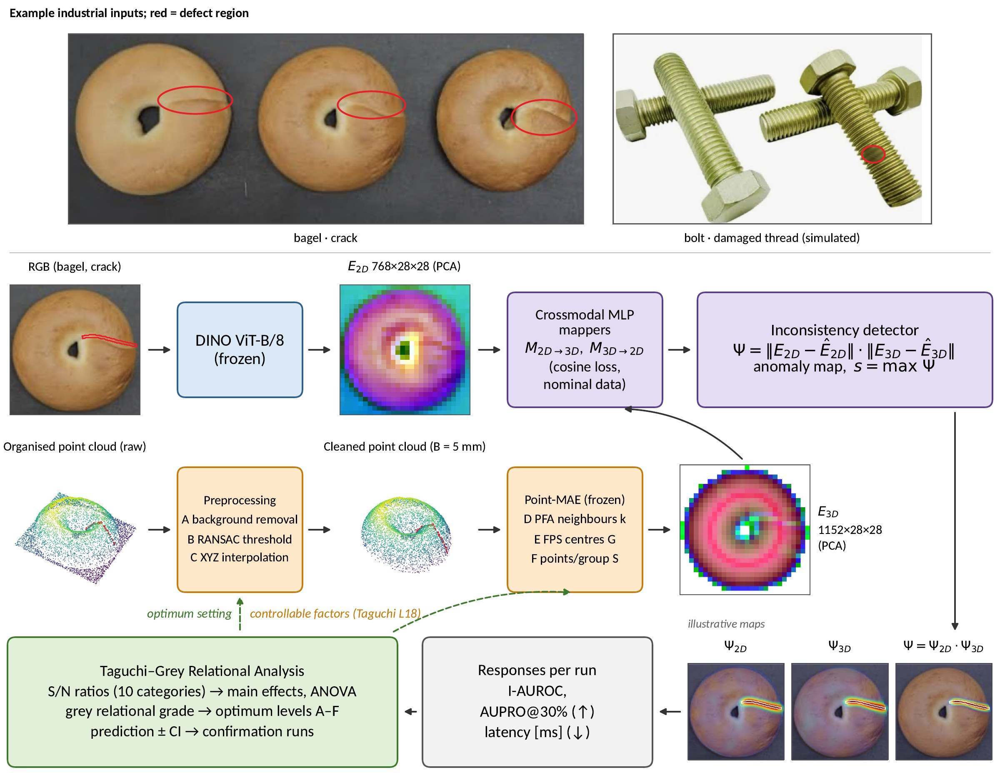
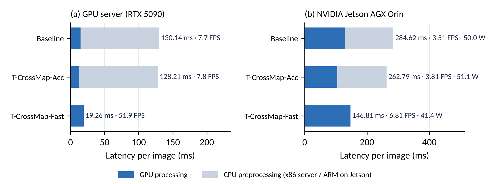
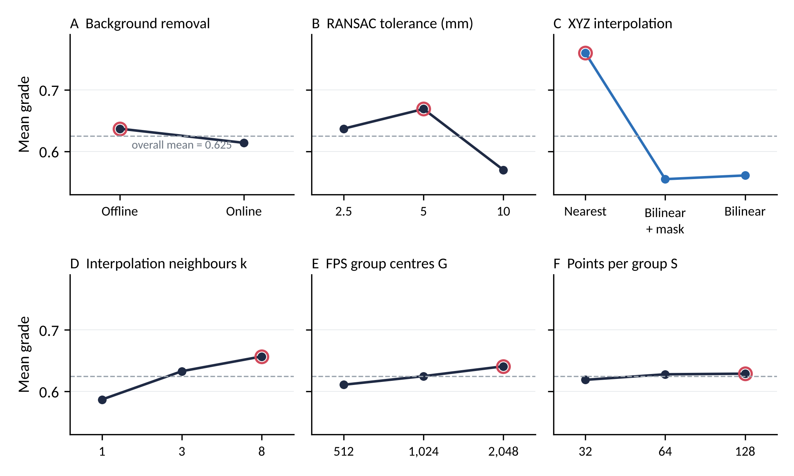

# T-CrossMap

**A Taguchi-Based Design-of-Experiments Framework for Point-Cloud Preprocessing of a Cross-Modal Mapper in RGB-3D Defect Detection**

Mas Nurul Achmadiah<sup>1,2</sup>, Wen-Kai Kuo<sup>1,*</sup>

<sup>1</sup> Department of Electro-Optical Engineering, National Formosa University, Taiwan
<sup>2</sup> Department of Electrical Engineering, Politeknik Negeri Malang, Indonesia
<sup>*</sup> Corresponding author: wkkuo@nfu.edu.tw

> Manuscript submitted to the *IAENG International Journal of Computer Science*.

---

## Overview

RGB-3D anomaly detectors depend on a point-cloud preprocessing stage: background removal, XYZ resizing, farthest point sampling (FPS), grouping and feature interpolation. Its settings are usually inherited from earlier code and tuned one factor at a time.

T-CrossMap treats these settings as **controllable process parameters** and selects them with a **two-stage Taguchi design of experiments** and **grey relational analysis (GRA)**. The selection balances three responses: image-level detection (I-AUROC), defect localisation (AUPRO@30%) and end-to-end latency. The detector, a crossmodal feature mapper (CFM) with frozen DINO ViT-B/8 and Point-MAE encoders, is not modified. Only 36 of the 486 possible configurations are tested.

<p align="center"></p>
<p align="center"></p>

## Controllable factors

| Factor | Description | Level 1 | Level 2 | Level 3 |
|---|---|---|---|---|
| A | Background-removal procedure | Offline (CPU) | Online (GPU) | – |
| B | RANSAC inlier tolerance ε (mm) | 2.5 | 5 | 10 |
| C | XYZ resize interpolation | Nearest | Bilinear + mask | Bilinear |
| D | Interpolation neighbours *k* | 1 | 3 | 8 |
| E | FPS group centres *G* | 512 | 1,024 | 2,048 |
| F | Points per group *S* | 32 | 64 | 128 |

The baseline is the conventional configuration A1 B2 C1 D2 E2 F1. The default of the CFM code is the same except for bilinear XYZ interpolation (C3).

**Stage 1 (L18 screening).** 18 runs × 10 categories. ANOVA shows that XYZ interpolation (C) contributes most to the grey relational grade (55.5%). The background-removal procedure (A) governs 95.4% of the variation in latency.
**Stage 2 (L9 refinement).** C is fixed at *nearest*, and B, D, E and F are refined separately for the offline and online modes. This gives two operating points.

| Operating point | Setting | Use case |
|---|---|---|
| **T-CrossMap-Acc** | A1 B1 C1 D1 E1 F3 (offline, 2.5 mm, nearest, *k* = 1, *G* = 512, *S* = 128) | Station inspection, accuracy first |
| **T-CrossMap-Fast** | A2 B2 C1 D1 E1 F3 (online, 5 mm, nearest, *k* = 1, *G* = 512, *S* = 128) | Inline inspection and edge devices |

## Main results (MVTec 3D-AD, mean of 10 categories)

Accuracy values are means of three seeds. Server latency was measured at batch size 1 and FP32 on an NVIDIA GeForce RTX 5090. Jetson values were measured on a Jetson AGX Orin (JetPack 6.2, MAXN, FP32, seed 0).

| Configuration | I-AUROC | AUPRO@30% | Server end-to-end (ms) | Server FPS | Jetson total (ms) | Jetson FPS | Jetson module power (W) |
|---|---|---|---|---|---|---|---|
| CFM default (bilinear XYZ) | 0.775 | 0.903 | 130.23 | 7.7 | – | – | – |
| Baseline (conventional) | 0.824 | 0.960 | 130.14 | 7.7 | 284.62 | 3.51 | 50.02 |
| **T-CrossMap-Acc** | **0.859** | **0.968** | 128.21 | 7.8 | 262.79 | 3.81 | 51.11 |
| **T-CrossMap-Fast** | 0.845 | 0.958 | **19.26** | **51.9** | **146.81** | **6.81** | **41.40** |

- On the server, CPU preprocessing takes 89% of the baseline latency. T-CrossMap-Fast moves background removal to the GPU and runs **6.8× faster end-to-end**.
- On the Jetson AGX Orin, T-CrossMap-Fast is **1.94× faster** than the baseline and uses about 8.6 W less module power.
- All configurations have 113.17 M parameters. The optimum settings need 128.1 GMACs, compared with 130.1 GMACs for the baseline.

<p align="center"></p>

### Per-category results (mean of three seeds)

| Metric | Setting | Bagel | Cable gland | Carrot | Cookie | Dowel | Foam | Peach | Potato | Rope | Tire | Mean |
|---|---|---|---|---|---|---|---|---|---|---|---|---|
| I-AUROC | Baseline | 0.905 | 0.662 | 0.915 | 0.850 | 0.905 | 0.894 | 0.767 | 0.714 | 0.968 | 0.661 | 0.824 |
| I-AUROC | T-CrossMap-Acc | 0.950 | 0.754 | 0.942 | 0.893 | 0.960 | 0.888 | 0.824 | 0.692 | 0.975 | 0.713 | **0.859** |
| I-AUROC | T-CrossMap-Fast | 0.929 | 0.820 | 0.913 | 0.890 | 0.858 | 0.907 | 0.839 | 0.686 | 0.928 | 0.681 | 0.845 |
| AUPRO@30% | Baseline | 0.964 | 0.958 | 0.979 | 0.943 | 0.961 | 0.950 | 0.965 | 0.972 | 0.933 | 0.971 | 0.960 |
| AUPRO@30% | T-CrossMap-Acc | 0.979 | 0.961 | 0.979 | 0.946 | 0.977 | 0.959 | 0.967 | 0.975 | 0.965 | 0.974 | **0.968** |
| AUPRO@30% | T-CrossMap-Fast | 0.973 | 0.948 | 0.978 | 0.951 | 0.925 | 0.953 | 0.972 | 0.975 | 0.947 | 0.959 | 0.958 |

### Taguchi confirmation (grey relational grade, three seeds)

| Mode | Optimum | Predicted | Observed | Best L9 run |
|---|---|---|---|---|
| Offline (A1) | B1 D1 E1 F3 | 0.9390 | 0.9050 ± 0.0062 | 0.8879 |
| Online (A2) | B2 D1 E1 F3 | 0.9399 | 0.9424 ± 0.0108 | 0.8767 |

<p align="center"></p>

## Installation

Tested environment:

- Ubuntu 24.04.5 LTS, Python 3.10.20, PyTorch 2.11.0 (CUDA 12.8, cuDNN 9.19.0) and Triton 3.6.0.
- NumPy 1.26.4, SciPy 1.15.3, scikit-learn 1.7.2, scikit-image 0.25.2 and tifffile 2025.5.10.
- Edge device: NVIDIA Jetson AGX Orin with JetPack 6.2.

```bash
git clone https://github.com/Masnurul17/T-Crossmap.git
cd T-Crossmap
conda create -n tcrossmap python=3.10 -y
conda activate tcrossmap
pip install -r requirements.txt
```

## Dataset

Download [MVTec 3D-AD](https://www.mvtec.com/company/research/datasets/mvtec-3d-ad) and extract it, for example to `data/mvtec_3d_anomaly_detection/`. The dataset contains 10 categories with RGB images and pixel-registered organised point clouds (`.tiff`).

## Usage

> The script names below are those used in the experiments. Run each script with `--help` to see the exact arguments.

```bash
# Stage 1: L18 screening (18 runs x 10 categories)
python run_taguchi.py --stage l18 --dataset_path data/mvtec_3d_anomaly_detection

# Stage 2: L9 refinement for the offline (A1) and online (A2) modes, with C fixed at nearest
python run_taguchi.py --stage l9 --mode A1
python run_taguchi.py --stage l9 --mode A2

# S/N ratios, grey relational analysis, ANOVA and additive prediction for the L9 stage
python analyze_l9.py

# Evaluate a single configuration (example: T-CrossMap-Acc)
python run_taguchi.py --eval --A 1 --B 2.5 --C nearest --D 1 --E 512 --F 128
```

All stochastic steps (RANSAC sampling, FPS start index and mapper training) are seeded, so every run is reproducible.

## Citation

If you find this work useful, please cite:

```bibtex
@article{achmadiah2026tcrossmap,
  author  = {Achmadiah, Mas Nurul and Kuo, Wen-Kai},
  title   = {{T-CrossMap}: A Taguchi-Based Design-of-Experiments Framework for Point-Cloud Preprocessing of a Cross-Modal Mapper in {RGB-3D} Defect Detection},
  journal = {IAENG International Journal of Computer Science},
  note    = {Under review},
  year    = {2026}
}
```

## Acknowledgements

This code builds on the following works:

- **Crossmodal Feature Mapping (CFM):** Costanzino et al., CVPR 2024.
- **M3DM:** Wang et al., CVPR 2023.
- **Point-MAE:** Pang et al., ECCV 2022.
- **DINO:** Caron et al., ICCV 2021.
- **MVTec 3D-AD dataset:** Bergmann et al., VISAPP 2022.

We thank the authors for releasing their code and data.

## License

See [LICENSE](LICENSE). The MVTec 3D-AD dataset is distributed under its own license (CC BY-NC-SA 4.0).
